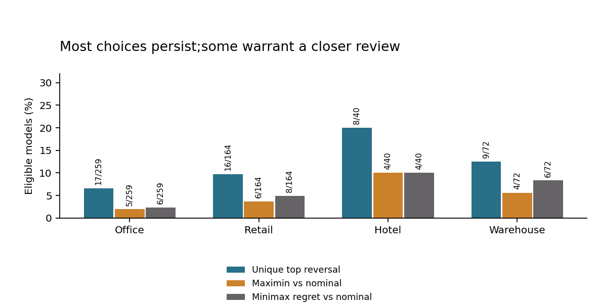

# Check a modeled retrofit choice against another weather case

Before buying a retrofit, check whether the model still puts it first under another supplied scenario. This study compares four separate ComStock measures and no action in two published weather-year simulation cases for Chittenden County, Vermont.

**Result:** 17 of 112 held Hotel and Warehouse model cases have a different unique top-ranked measure across the two cases. Maximin changes the nominal 2018 choice in 8 cases; minimax regret changes it in 10. Those changed IDs are a practical review list. The study does not measure field savings or investment returns.

| Fixed rule | Held IDs | Mean worst-case gain (pp) | Mean worst-case regret (pp) | Choices changed from nominal |
|---|---:|---:|---:|---:|
| Nominal: maximize 2018 gain | 112 | 6.285 | 0.119 | 0 |
| Maximin: maximize minimum gain | 112 | 6.299 | 0.059 | 8 |
| Minimax regret | 112 | 6.296 | 0.053 | 10 |

Gains and regrets are percentage points of each simulation case's baseline site energy. The objective inequalities follow from the finite optimization; they are not empirical proof of superiority. Equal-case averages are descriptive and assign no future-weather probabilities.



Read the [six-page independent manuscript](paper/manuscript.pdf) for the decision, source limits and full results. It is not peer reviewed. The [protocol](PROTOCOL.md) fixes the scope and checks. Source and technical evidence remain accessible below.

## Use the result

Inspect each changed model's full alternatives in [held choices](results/held_choices.csv) and [action outcomes](results/held_action_outcomes.csv). Obtain actual building inputs, installed costs, tariffs and field validation before an investment decision. These are unweighted simulation IDs, not a representative sample of physical buildings.

An implementation exercise:

1. Select an ID whose `different_from_nominal` is `True` in the choice export.
2. Join its action outcomes by `model_id`, `action` and `weather`; retain all feasible actions and both cases.
3. Recompute nominal, maximin and minimax regret from the exact gain columns. Resolve exact objective ties using the lower numeric upgrade ID, with no action first.
4. Explain which alternative changed and the gain/regret tradeoff. List the cost, site and scenario evidence still missing for a purchase decision. Keep missing records unknown.

The program's separate [research paper recommender](https://github.com/S3R3Bii/research-paper-recommender) supplies the recommendation-engine product and its implementation exercise.

## Source and case boundaries

ComStock 2025 Release 2, AMY2012 and AMY2018; baseline 0, LED Lighting 39, Lighting Controls 40, Roof Insulation 45 and New Windows 48. Individual measures are separate alternatives: their gains are never added into an unmodeled package. The source catalog and exact captured URLs are in the [manifest](data/source_manifest.json); [data rights](DATA_RIGHTS.md) retain attribution and change notices.

The 28,510 selected source records contain reallocated model copies. The ledger keeps every row; identical selected technical copies collapse to one full model ID. Of 882 reference IDs, 535 qualify: 423 Office/Retail development cases and 112 Hotel/Warehouse held cases. Another 219 IDs lack the paired 2012 records, including IDs outside the four analysis groups. Reasons overlap; these counts are not an additive flow chart. [Model exclusions](results/model_eligibility.csv) and the [source-row ledger](results/source_row_eligibility.csv.gz) preserve coverage and unknowns.

All three rules are fixed, with no learned parameters or policy selection. Twenty-eight dependency hashes were committed at `c61da1c` before held summaries. Both weather cases are known optimization inputs; the held archetypes are a separate descriptive application, not an unknown-weather forecast test. Duration bands describe source assumptions and do not establish occupancy effects. Matching selected inputs does not audit every underlying physical configuration or isolate weather causality.

One development action/case cell has negative gain and remains visible. The development top sets change in 34 cases, including one change involving a tie; only 33 are strict unique-top reversals. No negative held action/case cell is observed in this finite cohort. The source cases, cohort and measures cannot establish national effects or future-weather robustness.

## Reproduce and inspect

From a full-history checkout, Python 3.10 or 3.12:

```sh
python src/reproduce.py
python src/verify_figures.py
python -m pip install pypdf==6.10.0
python src/verify_paper.py
```

Core replay uses the standard library. Optional source recapture, private-original decoding and figure rebuilding use the pinned packages in `requirements.txt`. Source originals are privately retained; public source checks verify hashes/schema, not a new private-original decode.

The replay regenerates into separate temporary outputs and checks 447,801 CSV fields including headers, six JSON documents, 29 finite fixtures and the committed freeze proof, preserving original bytes. Local Python 3.10 and 3.12.14 runs pass. Independent checks cover 342,144 private-original projection comparisons, 328,115 input conditions, 87,283 development and 23,087 held conditions. These counts include structural/field checks, not independent physical observations. The figures have 32 recomputed values, 256 SVG coordinate checks and nine hashes; the manuscript has 103 independently reconstructed displays and 251 checks. All six rendered pages and three figures were inspected. See the [current receipt](REVIEW_RECEIPT.json).

Failed exact-number serialization and the figure-reader repair are retained in the review history. Objectives, precision allowances and cohort thresholds did not change. This independent program manuscript is authorized for public GitHub release; formal-publication projects including Azure optimization remain private. No costs, measured savings, adoption, new method or peer-review outcome are claimed.
